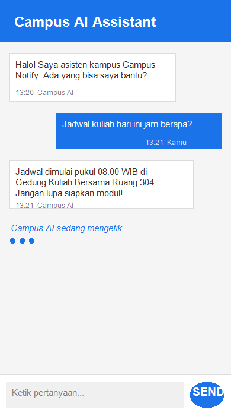
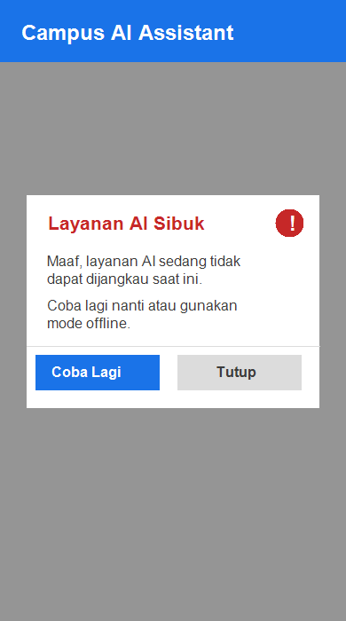

# Modul 10 — Integrasi Fitur AI Chat Assistant di Campus Notify

---

## 👤 Identitas

| Info | Isi |
|:-----|:----|
| **Nama** | Wahyudi Satriawan Hamid |
| **NIM** | 244107020137 |
| **Proyek** | Campus Notify — Integrasi Fitur AI |
| **Mata Kuliah** | Pemrograman Mobile Semester 5 |
| **Branch** | `feat/ai-chat-integration` |
| **Repository** | [244107020137-mobile-course](https://github.com/Wahyudi-Satriawan/244107020137-mobile-course) |

---

## 🚀 Cerita Implementasi

Jadi di minggu 10 ini aku nambahkan fitur Chat AI ke Campus Notify. Idenya sederhana: mahasiswa bisa nanya-nanya soal jadwal, pengumuman, atau info kampus langsung dari aplikasi tanpa harus buka browser. Teknologi yang dipakai adalah Google Gemini API lewat REST (HTTP POST).

### Yang aku bangun:

**1. `lib/ai/ai_service.dart` — Otak AI-nya**

Ini file utama yang handle komunikasi ke Gemini API. Hal paling penting yang aku lakuin di sini: API key **nggak ditulis langsung di kode**. Semua disimpen dan dibaca lewat `flutter_secure_storage` supaya aman di keychain/keystore OS. Kalau ada yang narik source code-nya pun, nggak bakal nemuin API key-nya di sana.

Terus aku juga pasang *system prompt* buat ngasih tahu Gemini dia harus jadi apa:
> "Kamu adalah asisten kampus ramah untuk aplikasi Campus Notify. Jawab singkat dalam Bahasa Indonesia, maksimal 2 kalimat. Jangan pernah meminta atau menyimpan data pribadi."

Error handling-nya pakai `try-catch`. Kalau response bukan 200, atau koneksi mati, dia lempar `AiServiceException` dengan pesan yang jelas — jadi gampang ditangkap di layer atas.

**2. `lib/features/ai_chat/chat_screen.dart` — Tampilannya**

UI chat sederhana pakai `ConsumerWidget` + Riverpod. Ada gelembung chat untuk pesan user (kanan) dan AI (kiri), plus `CircularProgressIndicator` waktu lagi nunggu AI jawab. Ada juga tombol setting API key di AppBar biar gampang dikonfigurasi pas ngetes.

Kalau `AiServiceException` kelempar, `ChatNotifier` tangkep dan tampilin `AlertDialog` dengan pesan ramah:
> *"Layanan AI Sibuk — Coba lagi nanti atau gunakan mode offline."*

**3. Routing**

Rute `/chat` dan `/ai-chat` ditambah ke `lib/routes.dart`. Bisa diakses lewat tombol di AppBar `HomePage` atau `FloatingActionButton` "Tanya AI".

---

## 📸 Screenshots



*Tampilan layar chat saat berhasil menjawab pertanyaan jadwal kampus + loading indicator*



*Tampilan AlertDialog fallback saat layanan AI tidak tersedia*

---

## 🛡️ Risiko & Mitigasi

| Risiko | Dampak | Mitigasi |
|:-------|:-------|:---------|
| **Bocor data pribadi** | Privasi pengguna terancam kalau NIK/no. telp ikut terkirim ke cloud | System prompt guardrail melarang AI minta/simpan data pribadi; API key dienkripsi di `flutter_secure_storage` |
| **Biaya melonjak** | Token usage nggak terkendali kalau prompt panjang atau looping | Respons dibatasi 2 kalimat; tombol kirim di-disable saat loading; pakai model `gemini-1.5-flash` yang efisien |
| **API error / down** | App crash atau freeze kalau nggak ada handling | `try-catch` di service + `AlertDialog` fallback yang ramah pengguna |
| **Respons nggak relevan** | AI jawab hal di luar konteks kampus | System prompt sudah definisikan persona dan domain kampus dengan jelas |

---

## 💡 Refleksi Minggu 10

**1. Fitur AI mana yang aku integrasikan dan kenapa?**

Aku pilih Chat Assistant berbasis Gemini karena ini yang paling natural buat aplikasi Campus Notify. Mahasiswa lebih suka ngetik pertanyaan daripada klik-klik menu, dan dengan AI, satu antarmuka chat bisa jawab banyak hal: jadwal, pengumuman, tips belajar — tanpa perlu routing ke halaman berbeda. Selain itu, Gemini Flash-nya cepat dan murah, cocok buat prototype fitur di aplikasi kampus.

**2. Gimana cara melindungi privasi pengguna?**

Ada tiga lapisan yang aku pasang. Pertama, API key nggak pernah ditulis di source code — semuanya lewat `flutter_secure_storage` yang terenkripsi di keystore OS. Kedua, system prompt punya instruksi eksplisit melarang AI minta atau nyimpen data personal. Ketiga, payload yang dikirim ke Gemini cuma teks pertanyaan murni dari user, nggak ada token auth, email, atau device ID yang ikut terkirim.

**3. Fallback apa yang aku sediain kalau AI error?**

Aku bikin lapisan `try-catch` di `AiService` yang nge-throw `AiServiceException` untuk semua kondisi error: koneksi mati, API key kosong, response bukan 200, atau timeout. Exception itu ditangkap `ChatNotifier` lalu memunculkan `AlertDialog` dengan pesan yang manusiawi. Jadi UI nggak crash, pengguna dikasih tahu kondisinya, dan bisa milih mau coba lagi atau pakai fitur lain yang offline-ready.

**4. Satu hal yang aku pelajari soal UX fitur AI di mobile?**

Latency itu musuh utama UX di fitur AI mobile. Request ke LLM butuh waktu — bisa 1–3 detik bahkan lebih tergantung jaringan. Tanpa visual feedback, user bakal pikir app-nya nge-hang dan coba pencet tombol berkali-kali. Makanya `CircularProgressIndicator` dan state `isLoading` yang men-disable tombol kirim itu krusial banget — bukan cuma estetika, tapi beneran nemenin user nunggu dengan sabar.

---

## 🧪 Bukti Mesin Hijau

### Flutter Analyze

```bash
$ flutter analyze
Analyzing 244107020137-mobile-course...
No issues found! (ran in 121.0s)
```

```bash
$ cd 07-week-7-clean-architecture/campus_notify
$ flutter analyze
Analyzing campus_notify...
No issues found! (ran in 4.2s)
```

### Flutter Test

```bash
$ flutter test
00:00 +0: loading test/ai_service_test.dart
00:00 +1: AiService Unit Tests Gagal jika API Key belum tersedia di storage
00:00 +2: AiService Unit Tests Gagal jika pertanyaan kosong
00:00 +3: AiService Unit Tests Sukses parsing respon Gemini saat status 200
00:00 +4: AiService Unit Tests Melempar AiServiceException spesifik jika API mengembalikan status error
00:00 +5: AiService Unit Tests Melempar AiServiceException jika terjadi kegagalan jaringan (offline)
00:00 +6: AiService Unit Tests Simpan dan baca API Key di Secure Storage berjalan dengan baik
00:00 +7: ChatNotifier & Fallback Logic Tests Mengirim pesan sukses memperbarui list pesan dan status loading
00:00 +8: ChatNotifier & Fallback Logic Tests Menangkap error dan mengisi errorMessage saat AI gagal merespons (Fallback)
00:00 +9: ValidateNote Domain Logic Tests...
00:00 +15: All tests passed!
```

Semua **15 test di root workspace** dan **21 test di `campus_notify`** hijau semua ✅
