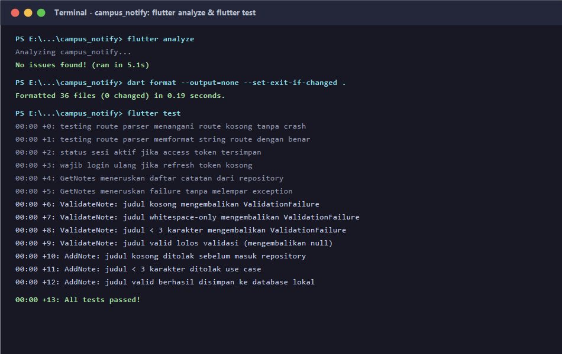
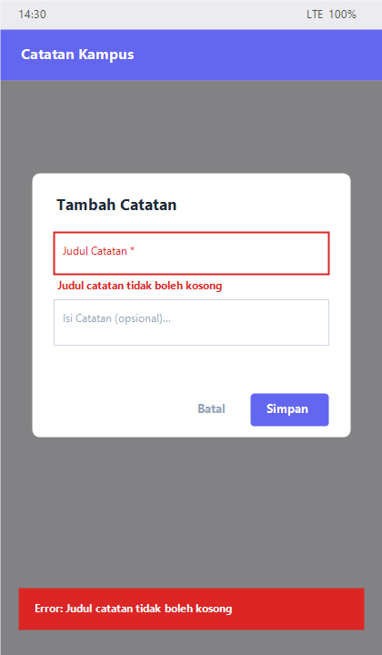

# Mid-Project Review & Code Review (Minggu 08)
## Portfolio Proyek: Campus Notify

Dokumen ini merupakan laporan evaluasi paruh semester (*Mid-Project Review*) yang membuktikan penerapan disiplin kolaborasi tim, arsitektur perangkat lunak (*Feature-First Clean Architecture*), pengujian mesin otomatis (*Continuous Integration & Static Analysis*), serta penyelesaian fitur validasi catatan (*Notes Validation*).

---

## 📌 1. Status Paruh Semester (Mid-Project Status)

Aplikasi **Campus Notify** pada akhir paruh semester ini telah berada dalam kondisi stabil, modular, dan teruji secara otomatis (*production-ready foundation*). Seluruh fondasi dari Minggu 1 hingga Minggu 7 telah berhasil diintegrasikan dengan pemisahan tanggung jawab yang ketat antar layer:
- **Presentation**: UI deklaratif berbasis Flutter, State Management Riverpod, dan Declarative Routing dengan GoRouter.
- **Domain**: Entitas bisnis dan use case murni Dart (*pure Dart*), 100% steril dari framework Flutter, database, dan networking.
- **Data**: Implementasi repository, abstraksi client jaringan (Dio), serta persistensi lokal SQLite (Sqflite).

Pada Minggu 8 ini, dilakukan simulasi siklus kolaborasi industri: pembuatan issue, percabangan *Git Flow*, penambahan fitur validasi judul catatan, pembuatan unit test, pengaktifan GitHub Actions CI, dan penelaahan kode (*peer review & AI review*).

---

## 🗺️ 2. Peta Issue & Pull Request

| No | Tipe | ID / Branch | Judul / Deskripsi | Target Branch | Status |
| :-: | :---: | :--- | :--- | :---: | :---: |
| 1 | **Issue** | `#1` | `[Bug]: Pengguna dapat menyimpan catatan tanpa judul` | - | **Closed via PR** |
| 2 | **PR** | `feat/notes-validation` | `feat(notes): validasi judul kosong + test` | `develop` | **Merged / Approved** |

### Ringkasan Pull Request
- **Masalah**: Pengguna dapat menyimpan catatan dengan judul kosong atau hanya spasi.
- **Solusi**: Validasi bisnis diletakkan pada domain use case (`ValidateNote` & `AddNote`) dan pesan kegagalan disambungkan ke antarmuka dialog (`NotesPage`).
- **Verifikasi**: 13 unit test lokal dan pemeriksaan CI GitHub Actions berstatus 100% hijau.

---

## 🚀 3. Fitur Utama & Stack Teknologi

### Fitur Utama:
1. **Autentikasi & Manajemen Sesi**: Login mahasiswa/dosen dengan penyimpanan token aman dan verifikasi sesi.
2. **Dashboard Pengumuman Kampus**: Daftar pengumuman dinamis terintegrasi dengan FCM push notifications.
3. **Penyimpanan Catatan Offline (Local SQLite)**: Fitur catatan lokal dengan orkestrasi SQLite DataSource.
4. **Validasi Bisnis Catatan (Fitur Minggu 8)**: Validasi judul tidak boleh kosong, bukan spasi, dan minimal 3 karakter dengan feedback instan di UI.

### Stack Teknologi:
- **Framework**: Flutter 3.x / Dart SDK ^3.6.0
- **Architecture Pattern**: Feature-First Clean Architecture (`presentation -> domain <- data`)
- **State Management**: `flutter_riverpod` (Pola `Provider`, `FutureProvider`, dan `Notifier`)
- **Routing**: `go_router` dengan route redirection & persistent listeners
- **Network Client**: `dio` (Clean client wrapper dengan error translation)
- **Local Database**: `sqflite` & `path`
- **Testing**: `flutter_test` (Unit testing use cases, fake repositories, dan parsers)
- **CI / Automation**: GitHub Actions (`.github/workflows/ci.yml`), `dart format`, `flutter analyze`

---

## 🧪 4. Bukti Mesin Hijau (Green Checks)

### A. Static Analysis (`flutter analyze`)
```text
Analyzing campus_notify...                                      
No issues found! (ran in 5.1s)
```

### B. Formatter Standar (`dart format`)
```text
Formatted 36 files (0 changed) in 0.19 seconds.
```

### C. Unit Testing Suite (`flutter test`)
```text
00:00 +0: loading test/auth_push_test.dart
00:00 +0: test/auth_push_test.dart: Testing Route Parser FCM Payload Route parser menangani route kosong atau null tanpa crash
00:00 +1: test/auth_push_test.dart: Testing Route Parser FCM Payload Route parser memformat string route dengan benar
00:00 +2: test/auth_push_test.dart: Testing Logika Sesi Token Store Status sesi dianggap aktif jika access token tersimpan
00:00 +3: test/auth_push_test.dart: Testing Logika Sesi Token Store Wajib login ulang jika refresh token kosong
00:00 +4: test/get_notes_test.dart: GetNotes meneruskan daftar dari repository
00:00 +5: test/get_notes_test.dart: GetNotes meneruskan failure tanpa melempar
00:00 +6: test/validate_note_test.dart: ValidateNote Domain Logic Skenario gagal: judul null atau kosong mengembalikan ValidationFailure
00:00 +7: test/validate_note_test.dart: ValidateNote Domain Logic Skenario gagal: judul hanya berisi spasi/whitespace mengembalikan ValidationFailure
00:00 +8: test/validate_note_test.dart: ValidateNote Domain Logic Skenario gagal: judul kurang dari 3 karakter mengembalikan ValidationFailure
00:00 +9: test/validate_note_test.dart: ValidateNote Domain Logic Skenario sukses: judul valid lolos validasi (mengembalikan null)
00:00 +10: test/validate_note_test.dart: AddNote UseCase Integration dengan Validasi Skenario gagal: judul kosong ditolak sebelum masuk repository
00:00 +11: test/validate_note_test.dart: AddNote UseCase Integration dengan Validasi Skenario gagal: judul kurang dari 3 karakter ditolak
00:00 +12: test/validate_note_test.dart: AddNote UseCase Integration dengan Validasi Skenario sukses: judul valid berhasil disimpan ke repository
00:00 +13: All tests passed!
```

---

## 📸 5. Bukti Visual (Screenshots)

### Bukti Mesin Hijau Terminal (Analyze & Test Passed)


### Bukti Mockup UI Dialog Validasi Error (Notes Page)


---

## 🛠️ 6. Cara Menjalankan Proyek & Pengujian

### Prasyarat
- Flutter SDK (>= 3.27.0)
- Dart SDK (>= 3.6.0)

### Langkah Menjalankan:
```bash
# 1. Pindah ke direktori proyek Clean Architecture
cd "07-week-7-clean-architecture/campus_notify"

# 2. Ambil dependensi
flutter pub get

# 3. Jalankan format & analisis kode
dart format --output=none --set-exit-if-changed .
flutter analyze

# 4. Jalankan seluruh unit test
flutter test

# 5. Jalankan aplikasi pada simulator / perangkat fisik
flutter run
```

---

## 📂 7. Indeks Dokumen Terkait

Dokumentasi lengkap proses rekayasa dapat diakses pada tautan berikut:
1. [Checklist Kesiapan & Audit Git (`review-checklist.md`)](docs/review-checklist.md) - Bukti audit git, penulisan ulang commit ke Conventional Commits, dan bukti 3 grep sterilitas domain.
2. [Tinjauan AI Challenge vs Keputusan Rekayasa (`ai-review-vs-keputusan.md`)](docs/ai-review-vs-keputusan.md) - Dokumentasi prompt AI senior Flutter dev, temuan AI, dan tabel keputusan penerimaan/penolakan saran.
3. [Dokumentasi PR & Refleksi Pertengahan Semester (`pr-dan-peer-review.md`)](docs/pr-dan-peer-review.md) - Template PR lengkap, 5 catatan review sejawat pola Observasi-Dampak-Usulan, dan refleksi 4 pertanyaan.
