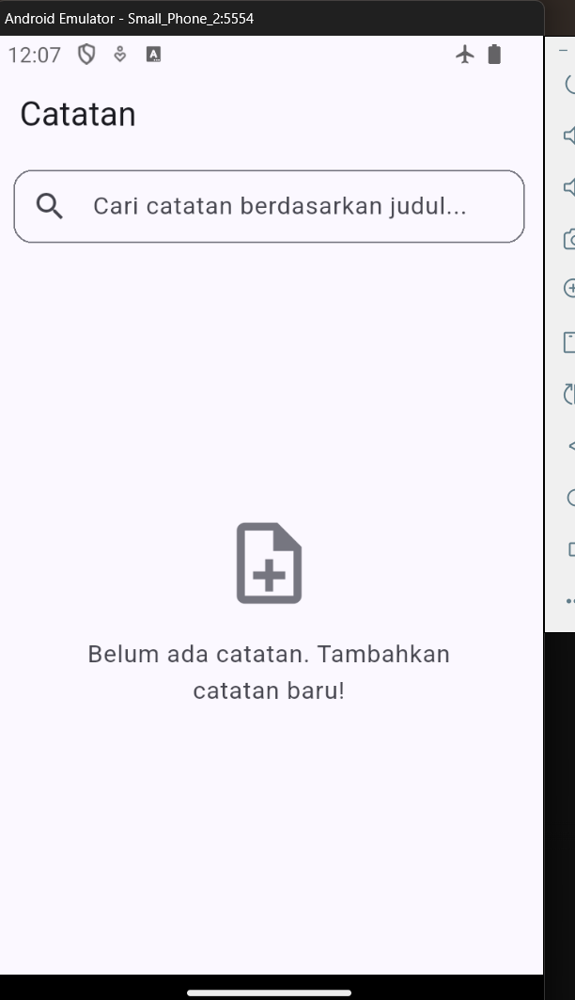
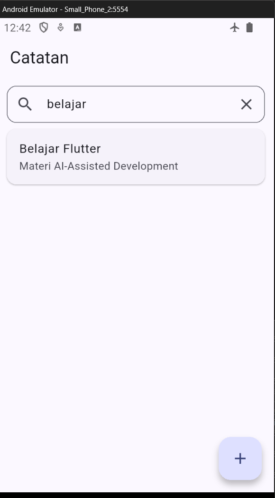
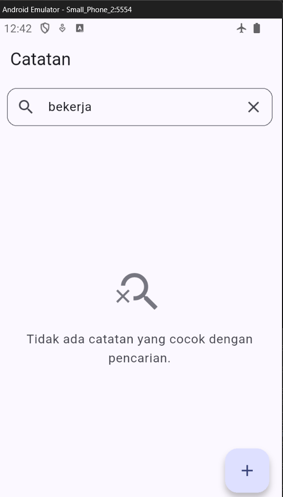

# Tugas Praktikum Week 9: AI-Assisted Development & Fitur Pencarian Catatan

Repositori ini berisi hasil pengerjaan tugas Week 9 mata kuliah Pemrograman Mobile. Fokus tugas minggu ini adalah menerapkan alur pengembangan berbantuan AI (*AI-assisted development*) untuk mengimplementasikan fitur pencarian catatan (*Search Notes by Title*) lengkap dengan tampilan *Empty State*, dengan tetap menjaga arsitektur *Clean Architecture* dan *state management* Riverpod 3.x.

---

## 🚀 Fitur yang Dikembangkan: Search Notes by Title & Empty State

Pada tugas ini, fitur pencarian catatan dibangun dengan aturan ketat agar tidak merusak arsitektur yang sudah ada:

1. **Pencarian Real-Time Berdasarkan Judul**:
   - Kolom pencarian (*search bar*) ditaruh di bagian atas layar catatan.
   - Pengguna bisa mengetik kata kunci apa saja, dan filter bekerja secara *case-insensitive* (tidak membedakan huruf besar/kecil).
   - Dilengkapi tombol *clear* (ikon silang) untuk mereset kata kunci secara instan.

2. **Pemisahan Logika ke Pure Domain Use Case**:
   - Sesuai prinsip *Clean Architecture*, seluruh logika pencarian ditaruh di dalam class `SearchNotesUseCase` di layer Domain (`lib/features/notes/domain/usecases/search_notes_usecase.dart`).
   - Use case ini murni Dart (tidak mengimpor paket Flutter maupun dependensi Riverpod/database), sehingga sangat mudah diuji lewat unit test.

3. **Empty State UI**:
   - Jika hasil pencarian tidak menemukan catatan yang cocok, halaman menampilkan widget khusus `EmptyStateView` dengan ikon pencarian kosong dan pesan informatif.
   - Jika memang belum ada catatan sama sekali di database, ditampilkan pesan ajakan untuk membuat catatan baru.

---

## 🛠️ Tech Stack

- **Framework**: Flutter 3.x (Dart SDK ^3.13.1, Material 3)
- **State Management**: `flutter_riverpod: ^3.4.3` (menggunakan pola `Notifier` dan `NotifierProvider` modern)
- **Architecture**: Feature-First Clean Architecture
  - `presentation`: Widget UI (`NotesPage`, `NotesList`), Notifier (`SearchQueryNotifier`), dan Providers.
  - `domain`: Entity (`Note`), Repository Contract (`NoteRepository`), dan Use Cases (`GetNotes`, `SearchNotesUseCase`).
  - `data`: Model (`NoteModel`), DataSource SQLite (`NoteLocalDataSource`), dan Implementasi Repository (`NoteRepositoryImpl`).
- **Database Lokal**: SQLite via `sqflite: ^2.4.5` & `path: ^1.9.1`
- **Testing**: `flutter_test` (Unit testing murni untuk logika use case)

---

## 🧪 Bukti Pengujian & Kualitas Kode (Green Checks)

Proyek ini telah melalui tahap analisis statis dan pengujian unit test dengan hasil bersih tanpa kendala:

### 1. Static Analysis
```bash
flutter analyze
```
**Hasil:**
```text
Analyzing week9_search_notes...                                 
No issues found! (ran in 2.9s)
```
- ✅ `flutter analyze` — **0 issues found**

---

### 2. Unit Testing
```bash
flutter test test/search_filter_test.dart
```
**Hasil:**
```text
00:00 +0: SearchNotesUseCase mengembalikan semua notes jika query kosong
00:00 +1: SearchNotesUseCase mengembalikan semua notes jika query hanya whitespace
00:00 +2: SearchNotesUseCase memfilter notes berdasarkan keyword di title (case-insensitive)
00:00 +3: SearchNotesUseCase mengembalikan list kosong jika tidak ada yang cocok
00:00 +4: SearchNotesUseCase mendukung pencarian parsial di tengah judul
00:00 +5: SearchNotesUseCase mengembalikan list kosong dari list notes kosong
00:00 +6: All tests passed!
```
- ✅ `flutter test test/search_filter_test.dart` — **Passed (6 test scenarios passed)**

---

## 📸 Tangkapan Layar Aplikasi (Screenshots)

Berikut adalah tangkapan layar tampilan aplikasi pada berbagai kondisi:

### 1. Tampilan Awal (Daftar Catatan)

*Tampilan awal daftar catatan saat memuat data dari database lokal.*

---

### 2. Tampilan Pencarian Berhasil

*Tampilan ketika pengguna mengetik kata kunci dan catatan berhasil difilter berdasarkan judul.*

---

### 3. Tampilan Pencarian Kosong (Empty State)

*Tampilan empty state saat kata kunci pencarian tidak cocok dengan judul catatan manapun.*

---

## 📂 Struktur Direktori Proyek

```text
09-week-9-ai-assisted-development/
├── docs/
│   └── ai-log.md                  <-- Log kolaborasi dan refleksi AI
├── screenshots/
│   ├── initial.png                <-- Placeholder screenshot awal
│   ├── search_empty.png           <-- Placeholder screenshot empty state
│   └── search_success.png         <-- Placeholder screenshot pencarian berhasil
├── week9_search_notes/
│   ├── lib/
│   │   ├── core/
│   │   │   ├── failures.dart
│   │   │   └── widgets/
│   │   │       ├── empty_state_view.dart
│   │   │       └── error_view.dart
│   │   ├── features/
│   │   │   └── notes/
│   │   │       ├── data/
│   │   │       │   ├── datasources/note_local_data_source.dart
│   │   │       │   ├── models/note_model.dart
│   │   │       │   └── repositories/note_repository_impl.dart
│   │   │       ├── domain/
│   │   │       │   ├── entities/note.dart
│   │   │       │   ├── repositories/note_repository.dart
│   │   │       │   └── usecases/
│   │   │       │       ├── get_notes.dart
│   │   │       │       └── search_notes_usecase.dart  <-- Pure Domain Use Case
│   │   │       └── presentation/
│   │   │           ├── pages/notes_page.dart
│   │   │           ├── providers/notes_providers.dart
│   │   │           └── widgets/notes_list.dart
│   │   └── main.dart
│   └── test/
│       └── search_filter_test.dart                    <-- Unit tests (hasLength & isEmpty)
└── README.md
```

---

*Laporan praktikum dan log detail interaksi dengan asisten AI dapat dilihat pada file [`docs/ai-log.md`](docs/ai-log.md).*
