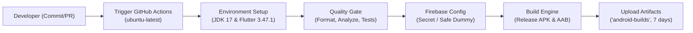
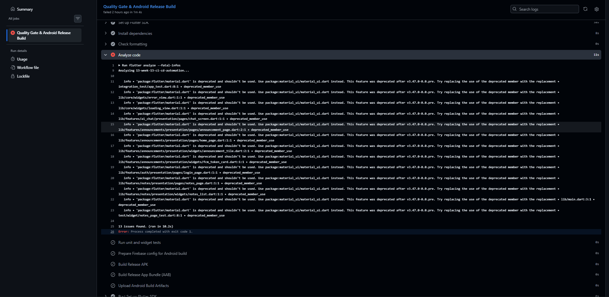
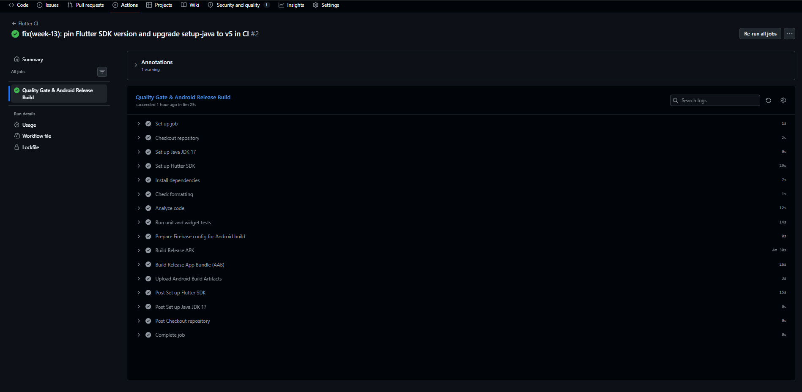

# Modul 13 — CI/CD dan Otomatisasi (Continuous Integration & Continuous Delivery)
**Aplikasi:** `campus_notify`  
**Mata Kuliah:** Pemrograman Mobile — Semester 5  
**Institusi:** Jurusan Teknologi Informasi — Politeknik Negeri Malang  

---

## 👤 Identitas Mahasiswa

| Atribut | Keterangan |
|:---|:---|
| **Nama** | Wahyudi Satriawan Hamid |
| **NIM** | 244107020137 |
| **Kelas** | TI 3H / Pemrograman Mobile |
| **Program Studi** | D-IV Teknik Informatika |
| **Modul Praktikum** | #13 \| CI/CD dan Otomatisasi |
| **Repositori GitHub** | [244107020137-mobile-course](https://github.com/Wahyudi-Satriawan/244107020137-mobile-course) |
| **Direktori Kerja** | `13-week-13-ci-cd-automation/` |
| **File Workflow CI** | [`.github/workflows/flutter-ci.yml`](../../.github/workflows/flutter-ci.yml) |
| **Versi Aplikasi** | `1.1.0+2` |
| **Git Release Tag** | `v1.1.0` (menunjuk pada commit `25f7724`) |

---

## 🎯 1. Tujuan Praktikum & Konsep Alur CI/CD

Praktikum Modul 13 berfokus pada implementasi pipeline otomasi pengujian, penjaminan kualitas kode, dan pembangunan artefak rilis Android menggunakan **GitHub Actions** pada repositori aplikasi `campus_notify`.

### A. Tujuan Pembelajaran
1. Menjelaskan dan memetakan alur kerja Continuous Integration (CI) dan Continuous Delivery (CD) dari pengajuan perubahan kode hingga pembentukan artefak biner.
2. Menyusun file konfigurasi workflow GitHub Actions multi-tahap yang mencakup formatting, static analysis, unit/widget testing, dan build Android.
3. Membangun artefak rilis ganda (**APK** untuk pengujian internal dan **AAB** untuk distribusi Google Play) serta menyimpannya sebagai *downloadable build artifacts*.
4. Menerapkan Semantic Versioning (`MAJOR.MINOR.PATCH+BUILD_NUMBER`) yang tersinkronisasi antara `pubspec.yaml`, Git Tag, dan riwayat pipeline.
5. Memahami batasan keamanan penyimpanan rahasia (*secrets management*), risiko dekompilasi `--dart-define`, dan isolasi lingkungan build.

### B. Konsep Alur CI/CD (Pipeline Lifecycle)
Pemeriksaan manual berulang rentan terhadap kesalahan manusia (*human error*) dan inkonsistensi lingkungan. Pipeline CI/CD mengubah proses verifikasi menjadi deterministik melalui tahapan terstruktur:



1. **Continuous Integration (CI):** Setiap commit yang di-*push* atau diajukan via *pull request* ke branch `main` secara otomatis memicu runner cloud untuk memeriksa standar format Dart (`dart format`), analisis aturan linter ketat (`flutter analyze --fatal-infos`), dan pengujian menyeluruh (`flutter test --coverage`).
2. **Continuous Delivery (CD):** Setelah seluruh gerbang kualitas (*quality gates*) terlewati 100%, sistem otomatis mengompilasi biner Android produksi (`app-release.apk` dan `app-release.aab`) dan mengunggahnya sebagai artefak resmi yang siap diunduh oleh tim QA atau Product Owner.

---

## 🏗️ 2. Arsitektur & Konfigurasi Pipeline (`flutter-ci.yml`)

Implementasi pipeline dikonfigurasi pada file [`.github/workflows/flutter-ci.yml`](../../.github/workflows/flutter-ci.yml) yang dirancang khusus untuk struktur proyek monorepo dengan prinsip keamanan dan efisiensi tingkat industri.

### A. Event Trigger & Concurrency Control
```yaml
name: Flutter CI

on:
  push:
    branches: [main]
  pull_request:
    branches: [main]
  workflow_dispatch:

permissions:
  contents: read

concurrency:
  group: ${{ github.workflow }}-${{ github.ref }}
  cancel-in-progress: true
```
* **Trigger:** Mendukung otomatisasi pada event `push` (branch utama), `pull_request` (validasi sebelum *merge*), dan `workflow_dispatch` (pemicu manual dari antarmuka GitHub).
* **Least Privilege Permission:** Dibatasi secara ketat hanya pada `contents: read` untuk mencegah kebocoran hak akses atau modifikasi repositori yang tidak diinginkan.
* **Concurrency Management:** Menggunakan `cancel-in-progress: true` untuk secara otomatis membatalkan build lama jika ada commit baru yang di-push pada branch yang sama, menghemat kuota komputasi GitHub Actions.

### B. Konteks Monorepo & Standardisasi Lingkungan
```yaml
jobs:
  test-and-build:
    name: Quality Gate & Android Release Build
    runs-on: ubuntu-latest
    defaults:
      run:
        working-directory: 13-week-13-ci-cd-automation
```
* **Working Directory:** Menetapkan `13-week-13-ci-cd-automation` sebagai konteks default eksekusi seluruh perintah Flutter/Dart agar terisolasi dari folder modul minggu lainnya.
* **Java SDK 17:** Dikonfigurasi menggunakan `actions/setup-java@v5` (distribusi `temurin`), memenuhi standar minimum Android Gradle Plugin (AGP) 9.1.0 dan Gradle 9.3.1.
* **Flutter Version Pinning:** Menggunakan `subosito/flutter-action@v2` dengan penguncian versi presisi pada `flutter-version: '3.47.1'` (`channel: 'stable'`, `cache: true`). Hal ini menjamin lingkungan runner identik dengan workstation lokal dan mencegah *SDK Version Drift*.

### C. Rangkaian Quality Gate Tanpa Kompromi
Pipeline menjalankan 4 lapisan pengujian berurutan:
1. `Install dependencies`: `flutter pub get` memverifikasi integritas resolusi pustaka dari `pubspec.lock`.
2. `Check formatting`: `dart format --output=none --set-exit-if-changed .` memastikan kode mematuhi panduan gaya resmi Dart tanpa toleransi deviasi format.
3. `Analyze code`: `flutter analyze --fatal-infos` memverifikasi kepatuhan linter di mana seluruh peringatan level *info* diperlakukan sebagai kesalahan fatal.
4. `Run unit and widget tests`: `flutter test --coverage` mengeksekusi 42 skenario pengujian unit dan widget test sekaligus menghasilkan laporan cakupan kode `coverage/lcov.info`.

### D. Strategi Injeksi Konfigurasi Firebase (`google-services.json`)
Untuk melindungi kredensial Firebase agar tidak pernah ter-commit ke Git publik, pipeline menerapkan strategi injeksi cerdas dua lapis:
```bash
if [ -n "$GOOGLE_SERVICES_JSON_BASE64" ]; then
  echo "Decoding GOOGLE_SERVICES_JSON_BASE64 secret into android/app/google-services.json..."
  echo "$GOOGLE_SERVICES_JSON_BASE64" | base64 --decode > android/app/google-services.json
else
  echo "No GOOGLE_SERVICES_JSON_BASE64 secret provided. Creating dummy google-services.json for safe CI build..."
  cat << 'EOF' > android/app/google-services.json
  {
    "project_info": { "project_number": "000000000000", "project_id": "dummy-campus-notify" },
    "client": [
      {
        "client_info": {
          "mobilesdk_app_id": "1:000000000000:android:0000000000000000000000",
          "android_client_info": { "package_name": "com.example.campus_notify" }
        },
        "api_key": [{ "current_key": "dummy_api_key_for_ci_build" }]
      }
    ],
    "configuration_version": "1"
  }
  EOF
fi
```
* **Jalur Produksi:** Jika secret `GOOGLE_SERVICES_JSON_BASE64` tersedia, konten didecode secara aman tanpa dicetak ke log.
* **Jalur Fallback Publik:** Jika pipeline dijalankan pada *pull request* publik atau fork tanpa secret, sistem menyuntikkan placeholder JSON berstruktur valid untuk package `com.example.campus_notify`. Hal ini mencegah plugin Gradle `processReleaseGoogleServices` mengalami *crash* saat kompilasi tanpa mengekspos kredensial backend asli.

### E. Kompilasi & Pengunggahan Artefak Rilis
```yaml
- name: Build Release APK
  run: flutter build apk --release

- name: Build Release App Bundle (AAB)
  run: flutter build appbundle --release

- name: Upload Android Build Artifacts
  uses: actions/upload-artifact@v4
  with:
    name: android-builds
    path: |
      13-week-13-ci-cd-automation/build/app/outputs/flutter-apk/app-release.apk
      13-week-13-ci-cd-automation/build/app/outputs/bundle/release/app-release.aab
    if-no-files-found: error
    retention-days: 7
```
Kedua artefak (`.apk` dan `.aab`) dikemas dalam satu paket unduhan `android-builds` dengan masa retensi penyimpanan selama 7 hari.

---

## 📊 3. Bukti Eksekusi Pipeline & Evaluasi Run #1 vs Run #2

### A. Perbandingan Hasil Eksekusi Pipeline

| Parameter Evaluasi | Run #1 (Studi Kasus Investigasi) | Run #2 (Final Release Verifikasi) |
|:---|:---|:---|
| **Commit Target** | [`2dd85bc`](https://github.com/Wahyudi-Satriawan/244107020137-mobile-course/commit/2dd85bc) | [`25f7724`](https://github.com/Wahyudi-Satriawan/244107020137-mobile-course/commit/25f7724) |
| **Pesan Commit** | `ci(week-13): add GitHub Actions Flutter CI workflow and bump version to 1.1.0+2` | `fix(week-13): pin Flutter SDK version and upgrade setup-java to v5 in CI` |
| **Status Akhir** | ❌ **Failed (Exit Code 1)** | ✅ **Succeeded (100% Green)** |
| **Total Durasi Job** | 1m 4s (Total Run: 1m 8s) | 6m 23s |
| **Titik Hambatan** | Step `Analyze code` (11 detik) | Tidak ada (seluruh 12 step lulus) |
| **Penyebab Utama** | SDK Version Drift (runner menarik Flutter terbaru tanpa version pinning, memicu 13 isu deprecation `package:flutter/material.dart`) | Masalah teratasi dengan mengunci versi Flutter pada `3.47.1` dan upgrade Java setup ke `v5` |
| **Artefak yang Dihasilkan** | *Tidak terbentuk (pipeline berhenti di tahap CI)* | `app-release.apk` (51.9 MB) & `app-release.aab` (50.9 MB) |

### B. Bukti Tangkapan Layar Eksekusi GitHub Actions

```
[ Tangkapan Layar Eksekusi Run #1 — Kegagalan Analisis Statis Akibat Version Drift ]
```
  
*Gambar 1: Kegagalan Run #1 pada tahap `Analyze code` akibat perbedaan versi SDK (commit `2dd85bc`).*

```
[ Tangkapan Layar Eksekusi Run #2 — Keberhasilan Penuh 100% Hijau ]
```
  
*Gambar 2: Keberhasilan Run #2 pada commit `25f7724` dengan seluruh step bertanda centang hijau (total waktu: 6m 23s).*

### C. Rincian Durasi Waktu Eksekusi Run #2 (Audit Telemetri Aktual)

| Step dalam Job `Quality Gate & Android Release Build` | Durasi Aktual | Status |
|:---|:---:|:---:|
| 1. Set up job | 1s | ✅ Passed |
| 2. Checkout repository (`actions/checkout@v4`) | 2s | ✅ Passed |
| 3. Set up Java JDK 17 (`actions/setup-java@v5`) | 0s | ✅ Passed |
| 4. Set up Flutter SDK 3.47.1 (`subosito/flutter-action@v2`) | 29s | ✅ Passed |
| 5. Install dependencies (`flutter pub get`) | 7s | ✅ Passed |
| 6. Check formatting (`dart format --output=none --set-exit-if-changed .`) | 1s | ✅ Passed |
| 7. Analyze code (`flutter analyze --fatal-infos`) | 12s | ✅ Passed |
| 8. Run unit and widget tests (`flutter test --coverage`, 42/42 passed) | 14s | ✅ Passed |
| 9. Prepare Firebase config for Android build | 0s | ✅ Passed |
| 10. Build Release APK (`flutter build apk --release`) | 4m 30s | ✅ Passed |
| 11. Build Release App Bundle (`flutter build appbundle --release`) | 26s | ✅ Passed |
| 12. Upload Android Build Artifacts (`actions/upload-artifact@v4`) | 3s | ✅ Passed |
| 13. Post steps & Complete job | 15s | ✅ Passed |
| **Total Waktu Pengerjaan Runner** | **6m 23s** | **Lulus Penuh** |

---

## 📦 4. Rincian Artefak Rilis Android

Kedua artefak biner dibangun menggunakan profil kompilasi `--release` dengan optimasi R8, desugaring dependensi, dan peniadaan icon font yang tidak digunakan (*font tree-shaking*):

| Nama Berkas Artefak | Format | Ukuran Aktual | Path Penyimpanan Lokal / CI | Peruntukan Distribusi |
|:---|:---:|:---:|:---|:---|
| `app-release.apk` | APK | **51.9 MB** | `build/app/outputs/flutter-apk/app-release.apk` | Pengujian tim QA internal, sideloading emulator, dan distribusi Firebase App Distribution. |
| `app-release.aab` | AAB | **50.9 MB** | `build/app/outputs/bundle/release/app-release.aab` | Format resmi Google Play Store (memungkinkan Dynamic Delivery & ukuran download pengguna akhir yang lebih kecil). |

---

## 🏷️ 5. Strategi Versioning, Rencana Versi Berikutnya & Analisis Keamanan

### A. Semantic Versioning Saat Ini
Aplikasi menerapkan format Semantic Versioning `1.1.0+2`:
* **Major (1):** Arsitektur inti stabil.
* **Minor (1):** Integrasi penjaminan kualitas menyeluruh (Modul 12) dan otomatisasi pipeline CI/CD (Modul 13).
* **Patch (0):** Tidak ada perbaikan bug minor setelah integrasi fitur baru.
* **Build Number (2):** Kenaikan build number dari `+1` menjadi `+2` untuk menandai iterasi kompilasi kedua pada rilis minor ini.
* **Git Tag:** Ditandai dengan annotated tag `v1.1.0` yang menunjuk pada commit terverifikasi `25f7724`.

### B. Rencana Versi Berikutnya
1. **Versi `1.1.1+3` (Patch Release):**
   * Migrasi action pihak ketiga ke rilis yang kompatibel penuh dengan Node.js 24 runner guna mengeliminasi warning transisi Node.js 20.
   * Optimalisasi konfigurasi cache Gradle di CI untuk mempercepat waktu kompilasi build APK.
2. **Versi `1.2.0+4` (Minor Feature Release):**
   * Implementasi Continuous Deployment otomatis: rilis AAB langsung diunggah ke Google Play Console Internal Track via `rdrussell/google-play-action`.
   * Integrasi penandatanganan aplikasi resmi (*production keystore signing*) menggunakan GitHub Secrets.

### C. Manajemen Secrets & Batasan `--dart-define`
* **Risiko `--dart-define`:** Argumen `--dart-define` sering disalahartikan sebagai tempat penyimpanan rahasia. Faktanya, seluruh string yang diteruskan melalui `--dart-define` **dikompilasi ke dalam biner aplikasi klien** dan dapat diekstrak dengan mudah menggunakan alat reverse-engineering (seperti `apktool`, `jadx`, atau pembaca biner string). Oleh karena itu, API Key sensitif (seperti Stripe Secret Key, Database Admin Credentials) dilarang keras dimasukkan via `--dart-define`.
* **Isolasi Secrets pada Pull Request:** GitHub Actions secara default menonaktifkan akses ke repository secrets untuk pull request yang berasal dari *forked repositories*. Desain workflow `flutter-ci.yml` yang menyediakan *safe dummy fallback* menjamin bahwa PR kontributor luar tetap dapat menjalankan pemeriksaan kompilasi tanpa membocorkan credential internal organisasi.

### D. Daftar Risiko Keamanan yang MASIH Perlu Ditangani Sebelum Rilis Produksi
Meskipun pipeline CI/CD telah lulus 100% hijau, aplikasi belum memenuhi syarat rilis komersial ke publik karena beberapa risiko berikut:
1. **Keystore Signing Masih Menggunakan Debug Key:**  
   Pada `android/app/build.gradle.kts`, blok `buildTypes.release` saat ini masih dikonfigurasi dengan:
   ```kotlin
   signingConfig = signingConfigs.getByName("debug")
   ```
   Aplikasi rilis yang ditandatangani dengan sertifikat debug akan ditolak oleh Google Play Store dan rentan terhadap pemalsuan aplikasi (*app spoofing*). Sebelum rilis publik, keystore produksi (`upload-keystore.jks`) wajib dibuat dan diinjeksikan melalui GitHub Secrets.
2. **Ketergantungan Firebase pada Fallback Dummy:**  
   Pada runner tanpa secret, aplikasi dibangun dengan dummy `google-services.json`. Jika artefak ini didistribusikan ke pengguna, fitur Push Notification (FCM) dan analitik Firebase akan mengalami *runtime exception*.
3. **Ketiadaan Branch Protection Rules:**  
   Branch `main` saat ini belum dikunci dengan proteksi branch. Pengembang masih dapat melakukan push langsung (*force push*) tanpa melalui mekanisme Pull Request dan *mandatory status checks*.
4. **Penyatuan Pipeline Pengujian dan Rilis:**  
   Saat ini, kompilasi APK dan AAB berjalan pada setiap push ke branch `main`. Pada skala produksi, proses pembangunan dan penandatanganan biner rilis sebaiknya dipisahkan ke dalam workflow terpisah yang hanya dipicu oleh Git Tag rilis (`v*.*.*`).

---

## 💡 6. Refleksi Pembelajaran Modul 13

### Pertanyaan 1: Masalah apa yang ditemukan otomatis sebelum perubahan di-merge?
> **Jawaban Evaluatif:**  
> Pipeline CI secara langsung membuktikan efektivitasnya melalui insiden **Run #1**. Ketika kode di-push, sistem otomasi langsung menghentikan proses (*hard block*) pada detik ke-11 tahap `Analyze code` karena mendeteksi 13 isu diagnostik akibat **SDK Version Drift**. Jika proses ini dilakukan secara manual di mesin lokal (di mana versi Flutter lokal berbeda dan tidak memunculkan warning), perbedaan standar kode ini akan lolos tanpa disadari ke branch utama. Otomatisasi CI memastikan bahwa setiap deviasi formatting, aturan linter, maupun regresi logika pada 42 unit/widget test terdeteksi seketika sebelum kode sempat digabungkan (*merge*) ke lini produksi.

### Pertanyaan 2: Informasi apa yang Anda butuhkan untuk menyelidiki build yang gagal?
> **Jawaban Evaluatif:**  
> Untuk melakukan investigasi insiden build secara tuntas (*Root Cause Analysis*), seorang DevOps Engineer membutuhkan:
> 1. **Commit Hash & Diff Perubahan:** Mengetahui berkas apa yang berubah dan siapa penyusunnya (`git show`, `git log`).
> 2. **Execution Logs dengan Exit Code:** Log konsol lengkap dari step yang gagal, termasuk nama file, nomor baris, dan kode diagnostik spesifik (pada Run #1: file log mencantumkan baris kode yang memuat `package:flutter/material.dart` dan exit code 1).
> 3. **Spesifikasi Runner & Versi Runtime:** Informasi versi OS runner (`ubuntu-24.04`), versi Java JDK (`temurin-17`), serta versi Flutter dan Dart SDK yang terpasang pada runner.
> 4. **Status Environment Variables & Secrets:** Verifikasi apakah variabel lingkungan atau secrets yang dibutuhkan tersedia tanpa membocorkan nilai aslinya.

### Pertanyaan 3: Bagian mana yang masih perlu persetujuan atau pemeriksaan manual sebelum rilis?
> **Jawaban Evaluatif:**  
> Keberhasilan kompilasi build biner hijau (*passing build*) hanyalah prasyarat teknis, bukan izin rilis final. Bagian yang tetap mewajibkan pemeriksaan dan persetujuan manual (*Human-in-the-Loop*) meliputi:
> 1. **Manual User Acceptance Testing (UAT) & Exploratory Testing:** Memasang APK rilis pada perangkat fisik nyata untuk memvalidasi interaksi visual, animasi, dan kenyamanan pengguna (*user experience*) yang tidak terjangkau oleh emulator pengujian.
> 2. **Verifikasi Keaslian Sertifikat Signing:** Memastikan bahwa biner rilis ditandatangani menggunakan release keystore resmi milik institusi/organisasi, bukan debug key.
> 3. **Tinjauan Kepatuhan Kebijakan Privasi & Izin Google Play:** Meninjau deklarasi izin Android (seperti notifikasi, lokasi, atau media) dan kepatuhan terhadap kebijakan privasi pengguna (*Data Safety Section* di Google Play Console).
> 4. **Otorisasi Rilis (Release Sign-off):** Persetujuan resmi dari Product Owner atau Release Manager sebelum memindahkan build dari Internal Testing Track ke Production Track.

---

## 📚 7. Referensi Pendukung

1. **Politeknik Negeri Malang.** (2026). *Slide Praktikum Minggu 13: CI/CD dan Otomatisasi*. Jurusan Teknologi Informasi.
2. **GitHub.** (2026). *GitHub Actions Documentation: Continuous integration and deployment workflows*. [https://docs.github.com/actions](https://docs.github.com/actions)
3. **Google Flutter Team.** (2026). *Continuous Delivery with Flutter*. Flutter Documentation. [https://docs.flutter.dev/deployment/cd](https://docs.flutter.dev/deployment/cd)
4. **Google Android Developer.** (2026). *Build and Release an Android App*. [https://docs.flutter.dev/deployment/android](https://docs.flutter.dev/deployment/android)
5. **GitHub Security.** (2026). *Using Secrets in GitHub Actions*. [https://docs.github.com/actions/security-guides/using-secrets-in-github-actions](https://docs.github.com/actions/security-guides/using-secrets-in-github-actions)
6. **Preston-Werner, T.** (2026). *Semantic Versioning 2.0.0 Specification*. [https://semver.org/](https://semver.org/)
